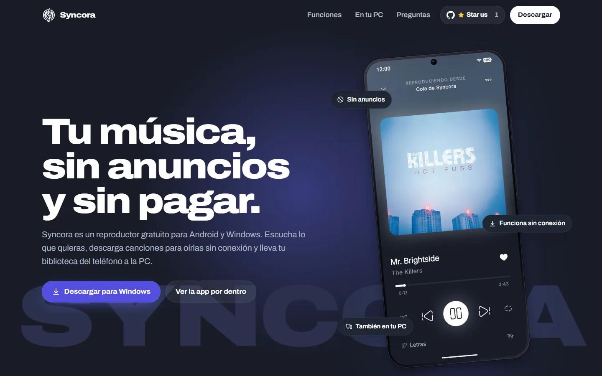
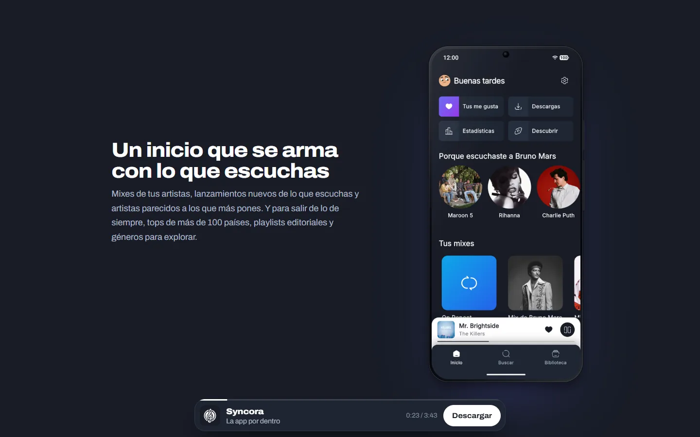
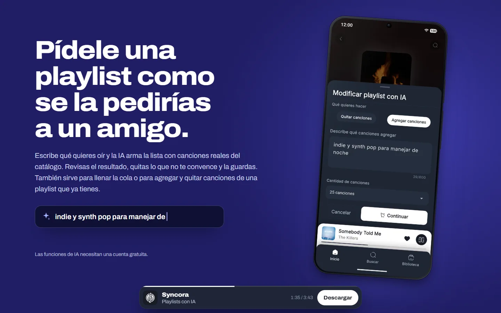
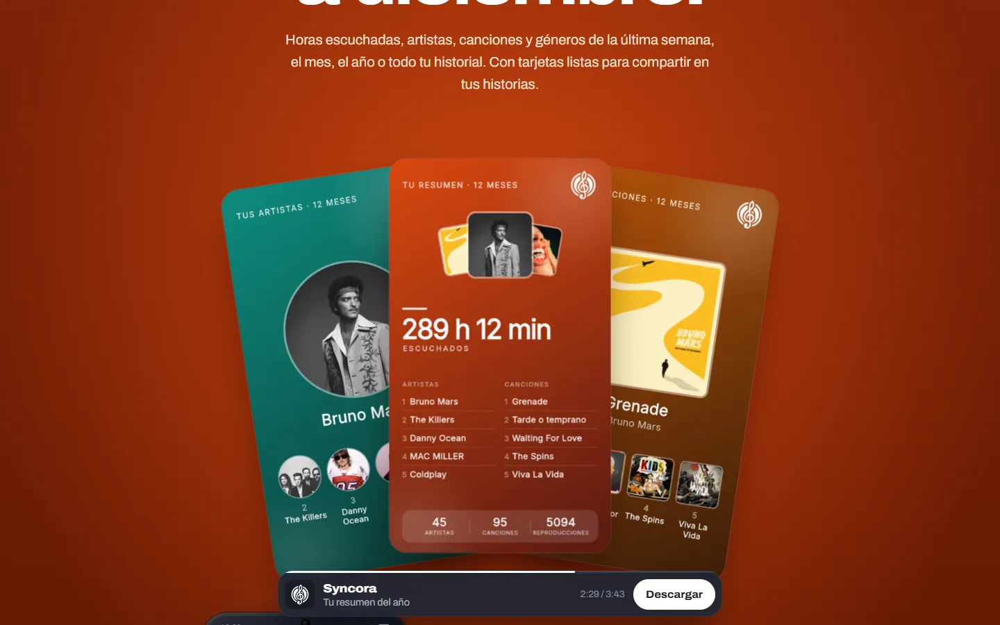
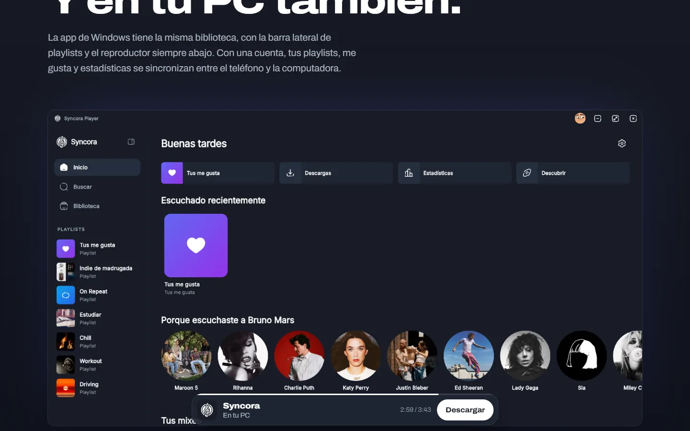
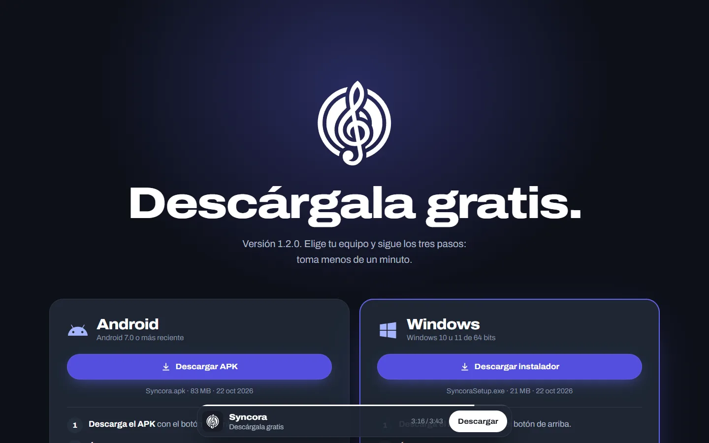
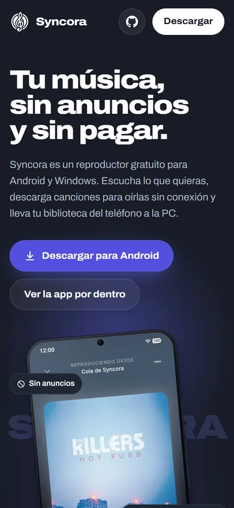
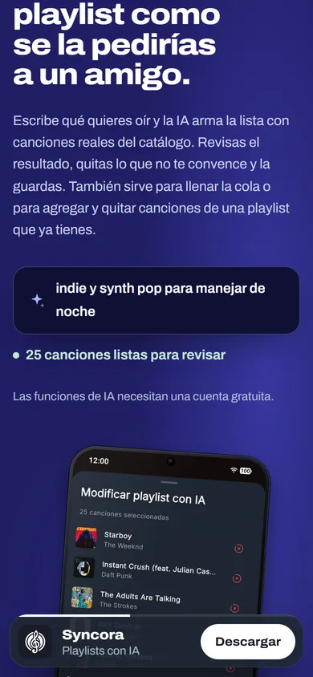
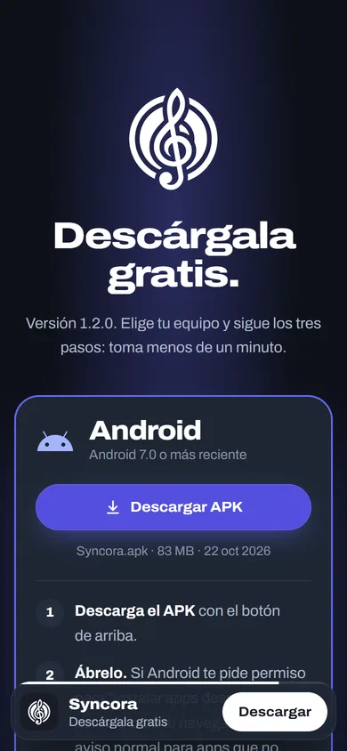

<div align="center">


# Syncora · Website

**The landing page of [Syncora Player](https://github.com/NotJcao17/syncora-player), a free music player for Android and Windows.**

*Show the real app, explain what makes it different, and get people from a shared link to an installed APK in under a minute.*

<a href="https://syncoraplayer.app"></a>
<a href="https://github.com/NotJcao17/syncora-player"></a>

[](https://astro.build)
[](https://tailwindcss.com)
[](https://gsap.com)
[](https://pages.cloudflare.com)

<br>



</div>

---

## What is this?

This repository is the promotional website for **Syncora Player**. It is a static Astro site with
scroll-driven animation, built for people who arrive from a phone, usually through a shared link,
with a few seconds of attention. Every claim on the page is backed by a real screenshot of the app
running in Android demo mode, and every download button points to the latest GitHub release.

The site is in **Spanish** (its audience is mostly Mexico and Latin America). Besides the landing
page it serves the privacy notice, the terms of use, a read-only view for playlists shared from the
app, and a small API that powers the download counter badge in the app's README.

---

## 📸 Screenshots

<div align="center">

&nbsp;


&nbsp;




<br><br>

&nbsp;
&nbsp;


</div>

---

## ✨ What's in it

- 🏠 **Landing page**: a scroll-driven tour of the real app (screenshots from Android demo mode).
- 📥 **Downloads that never go stale**: buttons point to the latest GitHub release and detect
  Android or Windows, so a new app version needs no change here.
- 🔗 **Shared playlists** (`/playlist/<id>`): read-only view of a playlist shared from the app.
- 📊 **Download counter API** (`/api/downloads`) for the badge in the app's README.
- ⚖️ Privacy notice, terms of use, SEO and Open Graph image.

---

## 🛠️ Tech Stack

| Layer | Technology |
| :--- | :--- |
| **Framework** | [Astro 7](https://astro.build) (static output) with React islands |
| **Styling** | Tailwind CSS 4, OKLCH color tokens, Archivo variable font |
| **Motion** | GSAP + ScrollTrigger, Lenis smooth scroll |
| **Images** | Astro image pipeline (`sharp`): AVIF and WebP at several widths |
| **Hosting** | Cloudflare Pages + Pages Functions |
| **Data** | GitHub Releases API (version and size), Supabase REST (shared playlists) |
| **Tooling** | TypeScript, `playwright-core` scripts for visual review and the OG image |

---

## 🏗️ Project Structure

| Path | What it is |
| :--- | :--- |
| `src/pages/index.astro` | The page: the order of the sections |
| `src/components/` | One section per file, plus `Phone` (Android frame), `Logo` and `DownloadButton` |
| `src/scripts/motion.ts` | All the motion: intro, hero, per-section scroll, mini player |
| `src/scripts/download.ts` | Detects Android/Windows and reads the latest version from GitHub |
| `src/data/site.ts` | Repo, download file names, requirements, SEO copy, legal date and contact |
| `src/data/logo.ts` | Logo vectorized from the app icon (clef and rings as separate paths) |
| `src/assets/screens/` | Real app screenshots (Android demo mode) |
| `src/pages/og.astro` | Source of `public/og.png` (not indexed) |
| `src/pages/privacidad.astro`, `terminos.astro` | Privacy notice and terms of use |
| `src/pages/playlist.astro` + `src/scripts/shared-playlist.ts` | Read-only view of a shared playlist |
| `functions/api/downloads.js` | Download counter for the shields.io badge |
| `public/_redirects` | Rewrites `/playlist/<id>` to the playlist page (Cloudflare Pages) |
| `public/_headers` | Security headers and long cache for `/_astro/*` |
| `PRODUCT.md`, `DESIGN.md` | Who the page is for and its visual system |

---

## 🚀 Getting Started

```bash
git clone https://github.com/NotJcao17/syncora-web.git
cd syncora-web
npm install
npm run dev        # http://localhost:4321
```

| Command | What it does |
| :--- | :--- |
| `npm run dev` | Development server |
| `npm run build` | Builds the static site into `dist/` |
| `npm run preview` | Serves `dist/` to check the build |
| `npm run check` | Type check (uses TypeScript 6: `astro check` does not support 7 yet) |

### Replacing screenshots

1. Take the screenshot on the phone with Android demo mode on.
2. Replace the file in `src/assets/screens/`, keeping the same name.
3. The Wrapped cards are cropped from the full screen: see `wrapped-*.png`.

Astro generates AVIF and WebP at several widths at build time.

### Social image and visual review

With `npm run dev` running:

```bash
node scripts/og.mjs                       # regenerates public/og.png
node scripts/shoot.mjs desktop capturas   # screenshots of every section (desktop)
node scripts/shoot.mjs mobile capturas    # same on a phone viewport
```

`shoot.mjs` uses the installed Chrome through `playwright-core`, so it does not download browsers.

### Shared playlists

The app copies `https://syncoraplayer.app/playlist/<id>` links and marks the playlist as public. The
page reads it from Supabase over REST with the `anon` key (public by design); row-level security
only returns playlists with `is_public = true`, so a private or deleted one shows as "not
available". Songs load 100 per page. Everything that comes from the database was written by a user,
so it is rendered with `textContent`, never as HTML.

`npm run dev` does not apply `_redirects`: to test locally use `/playlist/?id=<uuid>`.

### Download counter

`functions/api/downloads.js` sums the downloads of `Syncora.apk` and `SyncoraSetup.exe` across every
release that is not a prerelease (that leaves out the extraction engine channel) and is used by the
app's README:

```
https://img.shields.io/endpoint?url=https://syncoraplayer.app/api/downloads
```

An optional `GITHUB_TOKEN` environment variable (fine-grained, read-only access to public repos) can
be set on the Pages project to avoid rate limits.

---

## ☁️ Deploying to Cloudflare Pages

1. Cloudflare → Workers & Pages → Create → Pages → connect this repository.
2. Framework preset: **Astro**. Build command: `npm run build`. Output directory: `dist`.
3. Environment variable `NODE_VERSION` = `22` (or whatever you use locally).
4. The domain (`syncoraplayer.app`) is already set as `site` in `astro.config.mjs`.
5. Turn on Web Analytics from the Pages project (cookieless, no code needed).

If a new public page is added, include it in `src/pages/sitemap.xml.ts`.

---

<div align="center">
  Part of the <a href="https://github.com/NotJcao17/syncora-player">Syncora</a> family · Created by <b>Juan Carlos Orozco Nieto</b>
</div>
